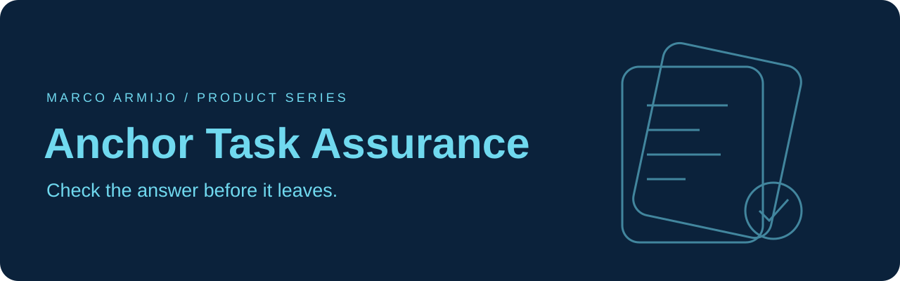

# Anchor Task Assurance

**The AI Fact-Checker — an evidence-and-review protocol with Python reference code.**

Anchor Task Assurance is a proposed protocol for deciding whether an AI-generated task result has the evidence and verification required for release. This repository contains the protocol documentation, a reference implementation and evaluation tooling. Created by Marco Armijo (R-Mijo).

The Python import is `anchor_task_assurance`, the installed distribution is `anchor-task-assurance`, and the command is `anchor`. The reference code demonstrates task classification, claim-to-source records, required verification checks, a conservative release gate and portable receipts. The protocol is experimental; it is not an independently certified or externally adopted standard.

## Protocol and tool: choose the right repository

| Repository | Role | Start here |
| --- | --- | --- |
| **Anchor Task Assurance — this repository** | Defines the Anchor evidence-and-review workflow and supplies reference code for answer-release checks. | [Protocol overview](docs/PROTOCOL.md) |
| **[ActionGate](https://github.com/R-Mijo/ActionGate)** | Software toolkit for applying evidence-release checks and controlling an agent's tool actions, approvals and operating limits. | [Runtime integration](https://github.com/R-Mijo/ActionGate/blob/main/docs/RUNTIME.md) |

**The protocol states what must be checked; the toolkit supplies controls an application can enforce.** A supported answer and an authorized business action are separate decisions. A release receipt never grants permission to issue a refund, send a message or change a record. See [how the projects fit together](docs/PROJECT_RELATIONSHIP.md).

**0.2.2 | Python 3.11+ | Proprietary | No third-party runtime dependencies**

The project demonstrates software behavior. It has not yet demonstrated that Anchor improves model accuracy, prevents prompt injection, or reduces business costs. The first release does not connect to a model provider, retrieve documents, authenticate approvers, execute payments, or provide a hosted service.

## In plain English

Anchor is the quality checkpoint for an AI-generated answer. It asks whether required checks were completed and whether important claims have acceptable evidence. For example, it can withhold a customer-care answer when its policy source is outdated. It does not execute refunds or prove a source is true.

## Run it in five minutes

Use Python 3.11 or newer. Download this repository and open a terminal in the folder containing this README. No third-party Python packages or API key are needed.

```powershell
python -m unittest discover -s tests -v
python -m anchor_task_assurance.cli demo
```

If `python` opens the Microsoft Store, follow [the Windows guide](docs/START_HERE_WINDOWS.md). The demo uses hand-authored fixtures and trusted example check results. It shows an accepted result, a blocked stale source, and checksum verification. It is not an LLM benchmark.

## What the gate does

- Rejects invalid scores and applies explicit minimum assurance controls for severe consequences, irreversible actions, and other sensitive conditions.
- Requires all eight named checks to be actual `True` values. Missing checks, empty material ledgers, unknown source IDs, unknown locators, unapproved sources, and inapplicable dates block release.
- Withholds unsupported or unverifiable material claims and escalates conflicts, material inferences, and restricted tasks awaiting human approval.
- Supports a separate trusted flag for workflow-required review; it does not infer expense exception rules from prose.
- Produces JSON receipt checksums that detect changes against a trusted digest.

A citation that exists is not necessarily a citation that supports a statement. Trusted independent verification must establish semantic support and inspect the entire output for omitted material claims. The library accepts verifier findings; it does not prove those findings are true. A checksum is not a signature or proof of accuracy.

`RELEASE` means permission to deliver the checked preliminary report. It never means payment authorization or permission to perform an external action.

## Test Anchor against real model responses

The corrected expense-review pack contains 30 synthetic cases. Every comparison condition receives the same facts, sources, outcome labels, and JSON output contract. Gold answers stay out of generated prompts.

```powershell
python -m anchor_task_assurance.cli prepare --directory results/pilot --repeats 3 --seed 20261029
python -m anchor_task_assurance.cli --help
```

Preparation creates randomized prompt packets and a manifest. It makes no model calls. Follow [the validation protocol](docs/VALIDATION_PROTOCOL.md) and [the Windows guide](docs/START_HERE_WINDOWS.md) to collect responses, prepare verifier packets, and screen results. Automated screening checks structure and exact fields; human review is required for substantive accuracy, claim coverage, authority, and evidence support. Do not publish screening matches as validated accuracy.

The Full Anchor condition D is a study design to complete. This release prepares its generator and verifier packets, but has no verifier-response importer or automatic connection from those responses to the gate. D screening reports generator drafts only and leaves final release unevaluated. See [the integration boundary](docs/APPLY_TO_YOUR_WORKFLOW.md).

## Read and contribute

- [Protocol overview and document map](docs/PROTOCOL.md)
- [Relationship to ActionGate and the shared company example](docs/PROJECT_RELATIONSHIP.md)
- [Methodology and revised prospectus](docs/METHODOLOGY.md)
- [Independent validation protocol](docs/VALIDATION_PROTOCOL.md)
- [Critical review of the original proposal](docs/CRITICAL_REVIEW.md)
- [Related work and limitations of the novelty claim](docs/RELATED_WORK.md)
- [Test results and what remains untested](docs/TEST_RESULTS.md)
- [Windows instructions and 24-hour launch plan](docs/START_HERE_WINDOWS.md)
- [Contributing](CONTRIBUTING.md)

## Why this project exists

AI outputs need more than fluent wording before entering a business workflow. Developers need a clear way to state required evidence, collect checks, make a delivery decision, and explain that decision later. Anchor explores a small implementation of that process.

The ingredients have substantial prior work, including [Microsoft Agentic Behavior Engineering](https://learn.microsoft.com/en-us/azure/architecture/ai-ml/guide/agentic-behavior-engineering), [NIST AI RMF](https://www.nist.gov/itl/ai-risk-management-framework), guardrail libraries, and assurance cases. Anchor's proposed contribution is its particular integration and usability. Its PAL thresholds and verifier policy are provisional design choices awaiting calibration.

Useful early contributions include a real provider adapter, independent replication, stronger verifier coverage records, workflow-specific policy configuration, authenticated approval records, and integration examples. A reproducible failure report is welcome.

Copyright (c) 2026 Marco A. See [LICENSE](LICENSE).

## Ownership

Copyright (c) 2026 Marco Armijo (R-Mijo). All rights reserved. The current revision is proprietary with publicly visible source. See [LICENSE](LICENSE). Earlier Anchor 0.2 material was public under MIT; existing grants are not revoked. See [licensing history](docs/LICENSING_HISTORY.md).
